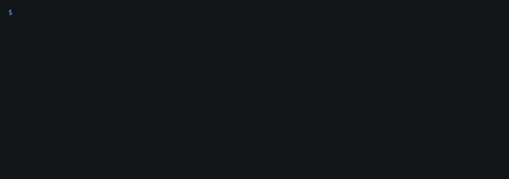

# daily-token-report

Once a day, re-check the coins you hold or follow and get told what changed: a grade that dropped, a new
flag (the owner can now mint, sells started failing), a pool that is gone. Quiet days stay quiet.



The GIF replays a real run (2026-11-07, saved in `docs/real_run_2026-11-07.txt` with the full CSV history).
The second token is a known honeypot: buys work, sells revert, grade F.

## Run it

One file, Python 3.9+, standard library only. No account or key for up to 3 tokens a day.

```sh
git clone https://github.com/cyberwarex/daily-token-report && cd daily-token-report
python3 daily_token_report.py watchlist.txt
```

`watchlist.txt` holds one token per line, `[chain] 0xaddress [label]`:

```
base 0x940181a94a35a4569e4529a3cdfb74e38fd98631 AERO
bsc  0x0e09fabb73bd3ade0a17ecc321fd13a19e81ce82 CAKE
```

Each run appends to `history.csv` (one row per token per day) and rewrites `report.md`. When something moved,
the report starts with it:

```
## Changed since last check (1)
- **Base AERO 0x9401...8631**: verdict ALLOW -> BLOCK (worse); grade A -> F; risk 5 -> 99; new flags: HONEYPOT_CONFIRMED
```

(That change line is from the tests; on the real run day nothing changed, as the GIF shows.)

## Run it every day for free on GitHub

Fork this repo, edit `watchlist.txt`, and turn on Actions in your fork. `.github/workflows/daily.yml` runs the
report at 06:17 UTC and commits `data/history.csv` and `data/report.md`. This repo runs it on its own
watchlist, so [data/report.md](data/report.md) is a live example.

On a laptop or server, cron works too: `17 6 * * * cd ~/daily-token-report && python3 daily_token_report.py watchlist.txt`.
A second run on the same day does nothing unless you add `--force`, so a cron mistake cannot spend checks twice.

## Send it to Telegram

```sh
export TG_BOT_TOKEN=123:abc TG_CHAT=-1001234567890
python3 daily_token_report.py watchlist.txt --telegram
```

It sends only on days when something changed or could not be checked; `--always-send` sends every day.

## Options

| flag | default | what it does |
|---|---|---|
| `--history` | `history.csv` | CSV history, appended each run |
| `--report` | `report.md` | markdown report, rewritten each run |
| `--telegram` | off | send the changes to `TG_CHAT` |
| `--always-send` | off | with `--telegram`, send on quiet days too |
| `--force` | off | run again on a day that is already in the history |

Exit code 0 = all checked, 2 = some tokens NOT CHECKED (still written to the report), 1 = bad input,
3 = Telegram send failed.

## Where the check comes from

Each token goes to the [CyberWareX safety oracle](https://oracle.cyberwarex.com) (`/risk/explain`).
It simulates a real buy and sell on the token's pool, reads who can mint, pause, blacklist or upgrade it,
and looks up the deployer's earlier tokens. Answer: ALLOW, LIMIT, RECHECK or BLOCK, a grade A to F and reason codes.

- 3 checks per IP per day are free, so a watchlist of 3 runs free.
- Past that, tokens show as `NOT CHECKED` with the reason; a token is never shown as unchanged or safe without a check.
  "Changed" always compares with the last day it was really checked.
- For more tokens set `CWX_KEY` to a prepaid key: pay once with any x402 client,
  `POST https://safe.cyberwarex.com/subscribe?usd=3` ($3 gives $3.30 of credit, about 600 checks at $0.005;
  a 25-token list checked daily is about $0.13 a day).
- At most 25 tokens per run, 3 seconds apart; a rate-limited answer is retried after the wait the oracle asks for.

Automated heuristics, not financial advice.

## Limits, said plainly

- Token contracts only, not pool or pair addresses; EVM chains base, bsc, ethereum, polygon, arbitrum.
- The oracle grade can move a little between two runs (a pool's depth changes); a change counts when the
  verdict, the grade or the flags change, or the risk score moves by 10 or more.
- A daily check is not a live alarm. For alerts the moment a coin lands in a wallet see
  [wallet-alert](https://github.com/cyberwarex/wallet-alert).

## Tests

```sh
python3 -m unittest -v
```

All network calls are stubbed; a test that tries a real call fails.

## Want it hosted, or built for your case?

We are testing whether people want this as a hosted service (no fork, no server: your list, your chat, plus
extras like wallets instead of a token list, Discord, or an action on a change). If you would use that, open a
[build request](https://github.com/cyberwarex/daily-token-report/issues/new?template=build-request.md)
with what you need and a rough budget, or leave a contact and budget on the short form at
[cyberwarex.com/gigs](https://cyberwarex.com/gigs) if you have no GitHub account. No promise yet; we count the requests to decide what to build.

Sister demos: [wallet-alert](https://github.com/cyberwarex/wallet-alert) (rug-checks every token a wallet receives)
and [token-check-bot](https://github.com/cyberwarex/token-check-bot) (a Telegram bot that checks any token posted in a group).

MIT license.
